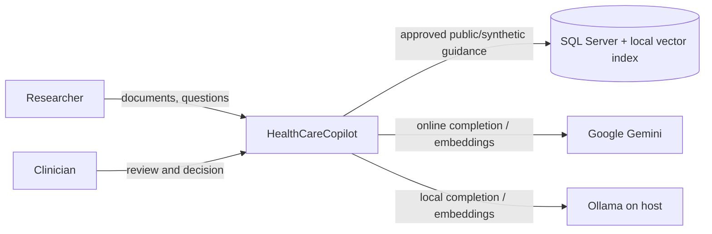
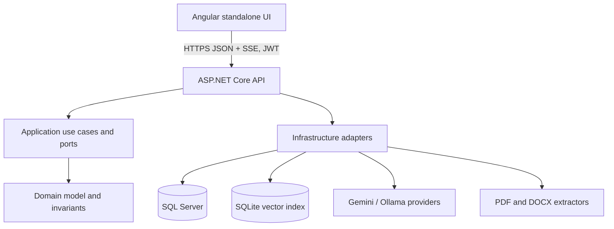
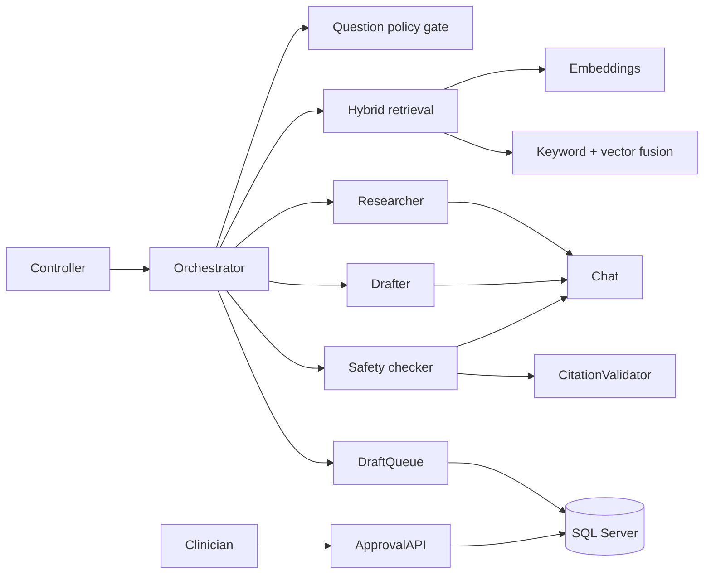
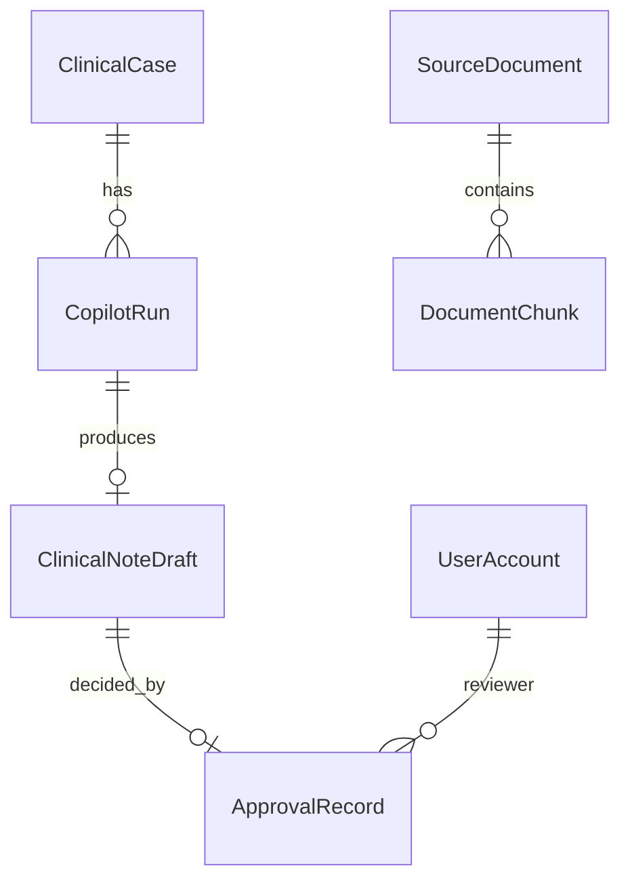

# Architecture

## C4 level 1 — system context



## C4 level 2 — containers



## C4 level 3 — workflow components



## Sequence — streamed run and human approval

```mermaid
sequenceDiagram
  actor User
  participant UI as Angular UI
  participant API as API/SSE
  participant App as Workflow orchestrator
  participant RAG as SQL + vector retrieval
  participant Model as Gemini/Ollama
  participant Clinician
  User->>UI: Submit question and case
  UI->>API: POST /api/copilot/drafts/stream (JWT)
  API->>App: Start request with cancellation token
  App->>RAG: Hybrid search
  RAG-->>App: Cited excerpts
  App-->>UI: SSE progress events
  par Research
    App->>Model: Research prompt + untrusted excerpts
  and Draft
    App->>Model: Draft prompt + untrusted excerpts
  end
  Model-->>App: Findings and draft
  App->>Model: Safety audit
  Model-->>App: Pass/fail + issues
  alt Safe and citations valid
    App->>RAG: Persist draft as AwaitingApproval
    API-->>UI: completed event with evidence and draft
    Clinician->>API: POST /api/drafts/{id}/review
    API-->>Clinician: Persisted decision
  else Unsafe, unsupported, or cancelled
    App-->>API: Refusal/cancel result; no draft approval
  end
```

## Data flow and trust boundaries

- Trust boundary A: browser to API. JWT authentication and server-side role policies apply; UI role hiding is not a security control.
- Trust boundary B: uploaded files and user questions are untrusted. Upload size/format are restricted; extracted text is data, never executable instruction.
- Trust boundary C: hosted model provider. In hosted mode, the question, a redacted case summary, and retrieved excerpts are sent to Gemini. Use synthetic/public material only. In local mode these prompts go to Ollama on the host.
- Trust boundary D: model response. JSON and citations are validated; model output cannot execute arbitrary tools or approve a note. Only the authenticated Clinician approval endpoint changes approval state.
- SQL Server stores cases, documents/chunks, runs, drafts, approvals and accounts. SQLite stores derived embeddings keyed by model identity.
- Do not log full prompts, excerpts, passwords, JWTs, or API keys. Correlation and trace identifiers are safe operational metadata.

## Entity relationship overview



`ApprovalRecord` captures reviewer identity, action, timestamp and optional edited content. `EvidenceCitation` links draft citations to document/chunk provenance. The SQLite vector index is a derived store and is not the authority for document metadata.

## Layer dependencies

`Domain` has no project dependencies. `Application` references `Domain` and owns use-case ports. `Infrastructure` implements those ports and references `Application` and `Domain`. `Api` composes the layers and owns HTTP concerns. `web/` consumes the HTTP contract and has no server-side authority. Tests depend inward; production layers never depend on test projects.
